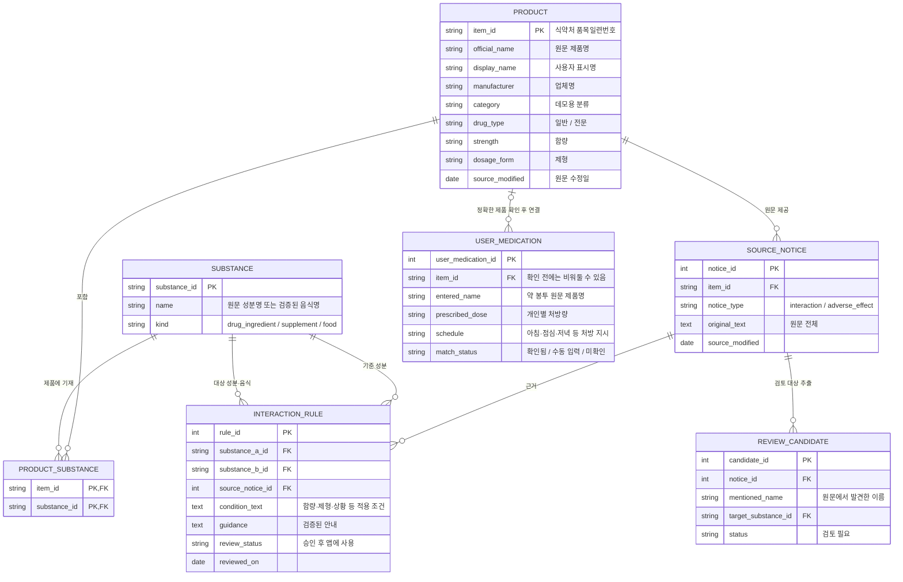

# MediSync AI — 대표 약 100개 데이터 관계 설계

## 이번 파일에서 만든 것

- 원본 e약은요 CSV 4,719개 제품 중 경구용 일반의약품을 중심으로 대표 제품 100개 선정
- 원문 표기 성분 142개, 제품–성분 연결 341건
- 같은 성분명이 기재된 제품 쌍 예시 40건
- 상호작용 원문에서 성분명이 언급된 검토 후보 30건
- **확정 상호작용 규칙 0건**: 자동 문자열 매칭 결과는 앱의 복용 경고로 사용하지 않음
- 현재 선정한 100개는 e약은요 기반 일반의약품이다. 병원 처방약은 아직 등록되지 않았다.

## ERD

## 연결을 해석하는 방법

1. `PRODUCT → PRODUCT_SUBSTANCE → SUBSTANCE`: 어떤 **제품에 어떤 성분이 기재됐는지** 보여준다. 원문 성분명을 임의로 합치지 않았다.
2. `PRODUCT → SOURCE_NOTICE`: e약은요 CSV의 **함께 사용할 때 주의할 약·음식**과 **이상반응** 문구를 제품별로 보존한다. 이상반응은 약 하나의 정보이고, 상호작용은 두 대상의 관계다.
3. `REVIEW_CANDIDATE`: 원문에 다른 성분명이 등장하는지 찾은 **문자열 매칭 후보**다. 제품·제형·함량·문장의 뜻을 아직 확인하지 않았으므로 복용 경고가 아니다.
4. `INTERACTION_RULE`: 출처와 적용 조건을 사람이 확인한 뒤에만 입력한다. 이 시트는 현재 비어 있다. 규칙이 없다는 것은 **안전하다는 뜻이 아니다**.
5. `USER_MEDICATION`: 사용자의 **실제 처방 지시**를 보관한다. 제품의 일반적인 용법과 섞지 않는다. OCR이 읽은 이름은 후보로만 제시하고, 사용자가 제품명·함량·제형을 확인한 뒤 `PRODUCT`에 연결한다. 검색되지 않으면 수동 입력으로 저장하되 안전 판정은 보류한다.

## 병원 처방약을 추가하는 방법

1. 약 봉투에서 제품명, 함량, 제형, 아침·점심·저녁 등의 복용 지시를 읽는다. OCR 결과는 사용자에게 확인받는다.
2. [의약품안전나라 제품정보 검색](https://nedrug.mfds.go.kr/searchDrug) 또는 [식약처 의약품 제품 허가정보](https://www.data.go.kr/data/15095677/openapi.do)에서 정확한 제품과 품목 코드를 찾아 `PRODUCT`에 등록한다. 동명이거나 함량·제형이 다른 제품을 이름만으로 합치지 않는다.
3. 제품의 주성분을 `SUBSTANCE`와 연결한다. 그 제품이 **전문의약품**인지도 기록한다.
4. 사용자의 복용량·시각은 제품 허가정보에서 추측하지 않고 약 봉투의 처방 지시를 `USER_MEDICATION`에 별도로 입력한다.
5. 병용금기 등은 [식약처 DUR 품목정보](https://www.data.go.kr/data/15059486/openapi.do) 같은 공식 근거를 검토해 규칙으로 추가한다. DUR에 없다는 이유만으로 안전하다고 표시하지 않는다. 음식·영양제 주의는 제품별 사용상 주의사항 등 별도 근거가 필요하다.

**4주 데모 범위:** 기존 일반의약품 100개는 검색용으로 유지하고, 처방약은 자주 나오는 제품 5~10개만 정확한 제품 단위로 추가한다. 나머지는 수동 입력·미확인 상태로 등록할 수 있게 한다.

## 4주 데모에서 구현할 흐름

제품 검색 → 제품 상세와 원문 주의사항 표시 → 약 봉투의 제품·복용 지시 확인 → 사용자가 복용 중인 제품 등록 → **동일 성분 중복 여부** 표시 → 검토 완료된 상호작용 규칙만 안내. 확인되지 않은 조합에는 “확인된 정보 없음, 약사와 상담”으로 표시한다.

약 봉투 OCR에서 추출한 제품명은 자동 확정하지 않고 사용자에게 제품명을 선택·확인받는다. 성분이나 복용 시각도 처방전·약 봉투의 지시를 우선한다.

## 파일 사용 순서

1. 엑셀의 `제품100` 시트에서 약 목록과 품목일련번호를 본다.
2. `제품성분`에서 제품과 성분의 연결을 확인한다.
3. `원문주의`에서 식약처 원문을 읽는다.
4. `검토후보`는 조사 목록으로만 쓴다. 원문을 확인하고 필요한 경우 약사의 검토를 받은 뒤 `확정규칙입력`에 기록한다.

**출처:** 사용자 제공 `e약은요정보검색.CSV`(식품의약품안전처 의약품안전나라), [e약은요 검색](https://nedrug.mfds.go.kr/searchEasyDrug). 이 자료는 일반의약품의 개요 정보이며 의약품의 모든 내용을 담지 않는다. 최종 서비스에는 원문 링크와 데이터 확인일을 함께 표시한다.
